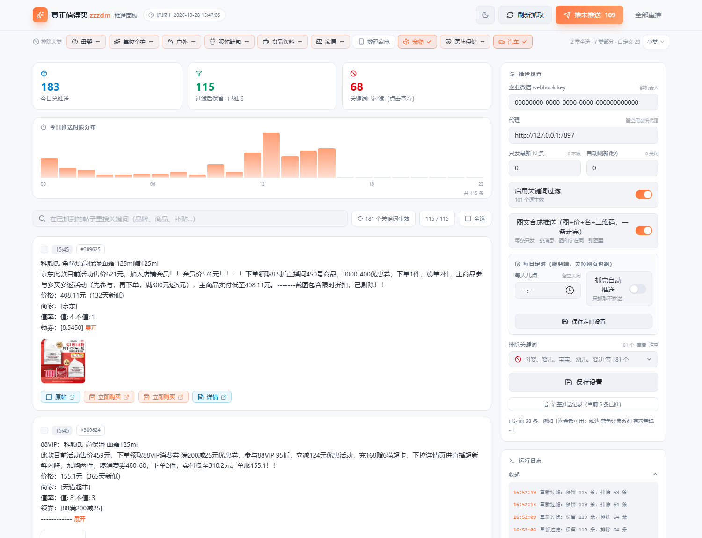
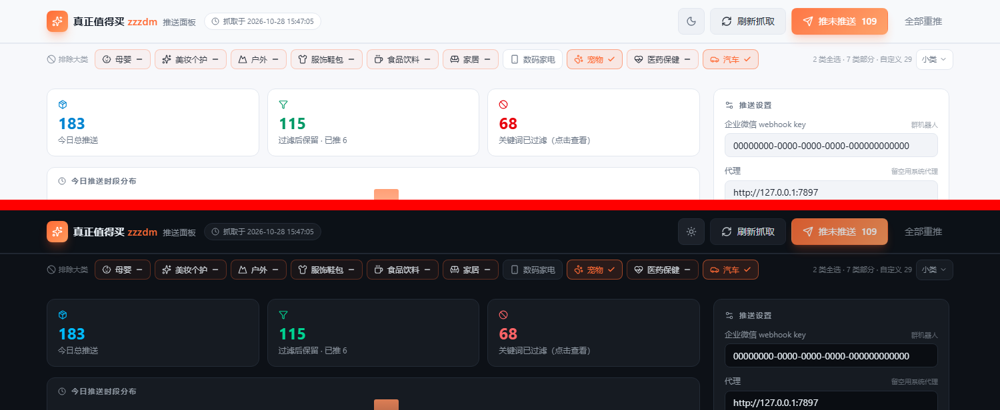

# zzzdm 推送面板

> 把 Telegram 频道 [@zzzdm](https://t.me/s/zzzdm)（真正值得买）的每日好价，自动整理成「一张看得懂的图」，定时送到你的企业微信群里。



---

## 这个项目解决什么问题

「真正值得买」是个很实在的导购频道，但它有三个不方便：

1. **只有 Telegram** —— 国内日常用微信的人，不会为了看几个好价专门挂梯子刷 Telegram。
2. **信息太密** —— 一天几十上百条，母婴、纸尿裤、宠物粮混在一起，真正想看的被淹掉。
3. **手机上看不出重点** —— 频道里的价格、商家、值率散落在几行文字里，滑过去就忘了。

这个面板做的事就是：**每天定时把频道内容捞下来 → 按你的口味过滤 → 重新排成一张图 → 推到你自己的微信群**。

不需要服务器，不需要注册任何服务，就是在自己电脑上跑一个 `python` 脚本。

---

## 亮点

### 一、一条消息 = 一张图，微信里看着就舒服

企业微信的 webhook 一条消息只能是「纯文字」「单张图」或「图文卡片」三选一，做不到「图 + 文字」混排。所以这个项目把**商品首图、到手价、品名、商家、值率、优惠券，再加上一个下单二维码，全部绘制成一张图片**再发出去。

结果就是：群里看到的是干净的一整张图，价格在最上面红色大字，扫右下角二维码直接下单——不会出现「图片一条、说明一条」的割裂感，也不是那种点开才看得清的小卡片。

> 图片链接点不动的问题，用右下角二维码解决了。
> 单图超过企业微信 2MB 限制时，会自动逐步降质重编码，兜底到能发出去为止。

### 二、排除关键词有「大类目录」，一次勾掉一整类

不用一个一个词地加。面板顶部是一条大类导航栏，内置 **10 个大类、49 个小类、350 个词**：

母婴 · 美妆个护 · 户外 · 服饰鞋包 · 食品饮料 · 家居 · 数码家电 · 宠物 · 医药保健 · 汽车

- 点一下大类 → 整类商品被排除
- 展开小类 → 可以只排除「纸尿裤」而不排除「玩具」
- 三态勾选框：全选 / 部分选中 / 未选，一眼看清状态
- 你自己加的词不会被目录操作误伤，「清空大类」只清目录里的词

**改完立即生效** —— 加一个词，已经抓下来的帖子会当场重新分拣，命中的从列表挪到「已排除」，不用重新抓一遍。

### 三、服务端定时，关掉网页也照跑

定时任务跑在 Python 后端，不是浏览器的 `setInterval`。设好「每天 9:30」，关掉浏览器、最小化窗口都不影响。

- 只在到点后 30 分钟内触发一次，服务起晚太多就当天不补跑，**避免一开电脑就给你刷一百条**
- 可以顺带勾上「抓完自动推送」，也可以只抓不发、等你自己挑

### 四、推送前先看一眼，想推哪条推哪条

面板不是「点一下全发出去」的黑盒：

- 帖子列表按时间倒序，每条都有图、有正文、有链接标签
- 勾选若干条 → 「推送勾选」只发这些
- 「推未推送」只发没发过的，重复点击不会刷屏
- 「全部重推」才是无视记录全量重发
- 每条都带「已推送」时间徽标，清楚知道哪些发过了

### 五、白天 / 夜间两套主题

右上角一键切换，跟随系统偏好，刷新不闪白。



### 六、关键词可以导入导出，能备份也能分享

排除列表支持 `.txt` / `.md` 导入导出，一行一个词，注释行自动忽略。想换台电脑、想把自己的词表发给朋友、想版本化管理，都可以。

### 七、零第三方依赖（后端）

`tg_zzzdm_to_wecom.py` 和 `webui_server.py` **纯 Python 标准库**，不用 `pip install` 任何东西就能跑。只有两个可选增强：

| 可选包 | 缺了会怎样 |
| --- | --- |
| `Pillow` | 图+文合成退化为「图一条、文字一条」 |
| `qrcode` | 卡片右下角不画二维码，只留链接文字 |

前端是 React + Vite + Tailwind，构建一次出静态文件，之后不装 `node_modules` 也能跑。

### 八、抓取不登录，不碰 Telegram API

走 `https://t.me/s/<channel>` 的公开预览页，纯 HTTP 抓取：不需要 API ID、不需要 session 文件、不需要手机号验证，也就没有被封号的风险。

---

## 界面速览

```
┌─────────────────────────────────────────────────────────────┐
│  真正值得买 zzzdm 推送面板      [☀] [刷新抓取] [推未推送 12] │
├─────────────────────────────────────────────────────────────┤
│  [母婴] [美妆个护] [户外] [服饰鞋包] [食品饮料] …  [小类 ▾]  │
├──────────────────────────────────┬──────────────────────────┤
│  今日总推送  过滤后保留  已过滤   │  推送设置                │
│     183         127        56    │   webhook key            │
│                                  │   代理                   │
│  今日推送时段分布 ▁▃▅▂▇▃▁        │   只发最新 N 条          │
│                                  │   自动刷新(秒)           │
│  [搜索框]            [全选]      │   启用关键词过滤         │
│                                  │   图文合成推送           │
│  ┌────────────────────────────┐  │   每日定时 09:30         │
│  │ [图] ¥129 千禾酱油 1.8L    │  │   ─────────────          │
│  │      京东 · 89人觉得值     │  │   排除关键词 …           │
│  │      券 10元       [✓]     │  │   [保存设置]             │
│  └────────────────────────────┘  │                          │
│  ┌────────────────────────────┐  │  运行日志                │
│  │ [图] ¥59 五常大米 5kg      │  │  15:32 抓取完成 183 条   │
│  └────────────────────────────┘  │  15:32 推送成功 12 条    │
│                                  │                          │
│  ⌄ 已排除 56 条（点开展开）      │                          │
└──────────────────────────────────┴──────────────────────────┘
```

---

## 快速开始

### 1. 准备

- Python 3.8+（Windows / macOS / Linux 都行）
- Node.js 18+（只在需要改前端时用）
- 一个企业微信群机器人的 webhook key

> 拿 key 的方式：企业微信群里 → 右上角 → 群机器人 → 添加 → 复制 webhook 地址，`key=` 后面那串就是。

### 2. 配置

```powershell
Copy-Item ui_config.example.json ui_config.json
```

打开 `ui_config.json`，把 `"key"` 填成你的 webhook key。

### 3. 构建前端（只需一次）

```powershell
cd ui
pnpm install
pnpm build
cd ..
```

### 4. 启动

```powershell
python webui_server.py
```

浏览器打开 <http://127.0.0.1:8765/>，点右上角「刷新抓取」就能看到今天的帖子。

### 只想要命令行版？

不想用面板、只想跑一次抓取推送：

```powershell
$env:ZZZDM_WEBHOOK_KEY = "你的 key"
python tg_zzzdm_to_wecom.py
```

常用参数：

```bash
python tg_zzzdm_to_wecom.py --dry-run          # 只打印预览，不发送
python tg_zzzdm_to_wecom.py --hours 24         # 取最近 24 小时（默认是今天 0 点至今）
python tg_zzzdm_to_wecom.py --latest 10        # 只发最新 10 条
python tg_zzzdm_to_wecom.py -p http://127.0.0.1:7890   # 指定代理
python tg_zzzdm_to_wecom.py --exclude 白酒,啤酒 # 临时追加排除词
python tg_zzzdm_to_wecom.py --no-images        # 只发纯文字
```

Windows 上还可以用 `run_zzzdm.bat`（读 `ZZZDM_WEBHOOK_KEY` 环境变量），配合任务计划程序做系统级定时。

---

## 配置项说明

`ui_config.json` 由面板「推送设置」自动维护，也可以手工改：

| 键 | 类型 | 说明 |
| --- | --- | --- |
| `key` | string | 企业微信群机器人 webhook key（**别提交到仓库**） |
| `proxy` | string | 抓取 Telegram 用的 HTTP 代理，留空则直连 |
| `tz` | number | 时区偏移，默认 `8.0` |
| `exclude` | string[] | 排除关键词列表，命中即过滤 |
| `filter_enabled` | bool | 是否启用关键词过滤 |
| `latest` | number | 只展示/推送最近 N 条，`0` 表示全部 |
| `push_images` | bool | 是否合成图文卡片推送（关掉则发纯文字） |
| `auto_refresh_sec` | number | 面板自动刷新间隔，`0` 关闭 |
| `auto_push` | bool | 定时抓取后是否自动推送 |
| `daily_time` | string | 每日定时执行时刻 `"HH:MM"`，空表示关闭 |
| `skip_pushed` | bool | 是否跳过已推送过的帖子 |

---

## 目录结构

```
.
├── tg_zzzdm_to_wecom.py     # 抓取 / 解析 / 过滤 / 合成卡片 / 推送（纯标准库）
├── webui_server.py          # 本地 Web 服务，提供 API 并托管前端
├── run_zzzdm.bat            # Windows 一键脚本（读环境变量中的 key）
├── ui_config.example.json   # 配置模板，复制成 ui_config.json 使用
├── assets/                  # README 用的截图
└── ui/                      # React 19 + Vite 7 + TS + Tailwind v4 面板
    ├── src/
    │   ├── App.tsx              # 主界面
    │   ├── components/
    │   │   ├── CategoryNav.tsx      # 大类 / 小类排除导航
    │   │   ├── KeywordEditor.tsx    # 关键词编辑、导入导出
    │   │   ├── PostCard.tsx         # 帖子卡片
    │   │   ├── ExcludedDrawer.tsx   # 已排除抽屉
    │   │   ├── Lightbox.tsx         # 图片查看
    │   │   └── HourChart.tsx        # 时段分布（纯 SVG）
    │   └── lib/
    │       ├── catalog.ts       # 10 大类 / 49 小类 / 350 词目录
    │       ├── keywords.ts      # 关键词文件读写
    │       └── theme.ts         # 白天/夜间主题
    └── dist/                    # 构建产物（后端优先托管这里）
```

---

## 本地数据（都在这台机器上，不进仓库）

| 路径 | 内容 |
| --- | --- |
| `ui_config.json` | 配置，含 webhook key |
| `ui_config.json.bak` | 上一版配置自动备份 |
| `ui_state.json` | 已推送记录、定时任务上次运行时间 |
| `logs/YYYY-MM-DD.log` | 每日运行日志 |

配置采用「临时文件 + fsync + 原子替换」写入，断电或强杀进程不会写出半个 JSON；解析失败会把坏文件备份成 `.broken` 再回退默认值，不会静默丢配置。

---

## 常见问题

**Q：抓不到内容？**
Telegram 在国内需要代理。在面板「推送设置 → 代理」里填 `http://127.0.0.1:7890`（按你的客户端改）。部署在境外服务器上可以留空。

**Q：推送的图里没二维码？**
装一下 `pip install qrcode`。不装也能用，只是右下角只有链接文字。

**Q：能不能推给多个群？**
每个群机器人有独立的 key，一个面板同一时间对应一个 key。想推多个群，复制一份目录、改 `ui_config.json` 里的 key 和端口即可。

**Q：能不能部署到服务器上？**
可以，`python webui_server.py --host 0.0.0.0 --port 8765`。但面板**没有鉴权**，公网暴露等于把配置和推送能力交出去，务必套 Nginx Basic Auth 或只在内网访问。

**Q：定时不准？**
定时任务在到点后 30 分钟窗口内触发，服务没启动的那段时间不会补跑。想严格准点，用系统任务计划程序调 CLI 更可靠。

---

## 免责

个人自用好价信息聚合工具，抓取的均为频道公开内容。请遵守 Telegram 与目标频道的规定，不要用于商业分发或高频抓取。

代码无许可证，随意使用。
